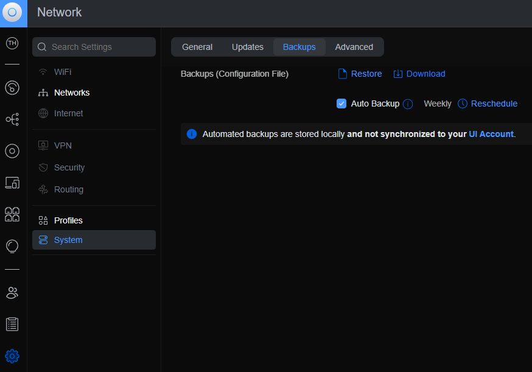
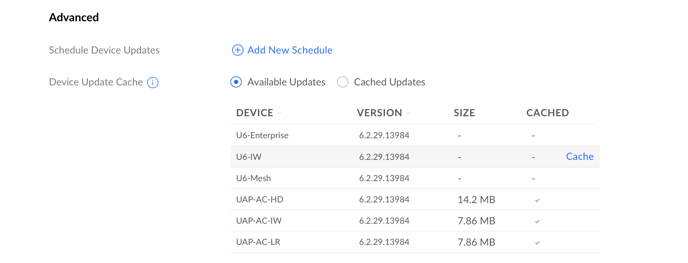
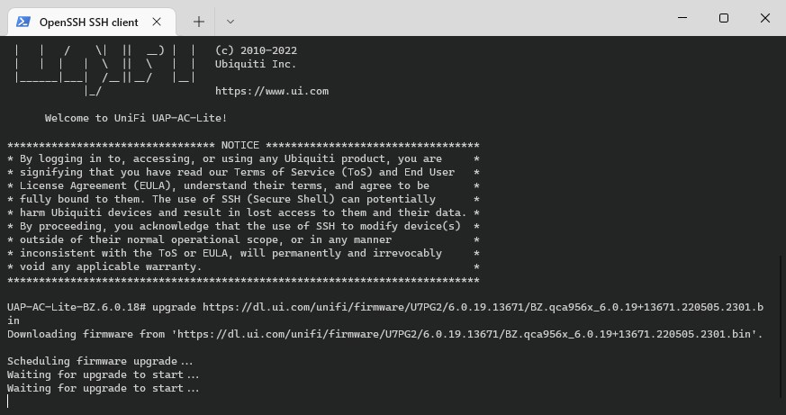

# UniFi: бэкап и обновление на Ubuntu Server

**Сценарий:** контроллер UniFi Network на Ubuntu Server → бэкап → обновление контроллера → последовательное обновление точек доступа (AP) по одной.


## Оглавление

- [0. Ограничения для РФ — прочитать первым](#0-ограничения-для-рф--прочитать-первым)
- [1. Подготовка (чек-лист)](#1-подготовка-чек-лист)
- [2. Бэкап контроллера](#2-бэкап-контроллера)
- [3. Обновление контроллера на Ubuntu](#3-обновление-контроллера-на-ubuntu)
- [4. Последовательное обновление точек доступа](#4-последовательное-обновление-точек-доступа)
- [5. Проверка и откат](#5-проверка-и-откат)
- [6. Частые ошибки](#6-частые-ошибки)

---

## 0. Ограничения для РФ — прочитать первым

> **Коротко:** «кирпичей» нет, локальный контроллер и точки работают. Серверы Ubiquiti блокируют российские IP (`www.ui.com`, `fw-download.ubnt.com`, а у части провайдеров и `dl.ui.com` отвечает `451`), но **архив Glenn R. на `api.glennr.nl` (Нидерланды), `repo.mongodb.org` и GitHub из РФ открываются** — поэтому контроллер можно обновить **без VPN**. Автообновление точек кнопкой в Web UI при этом всё равно не работает: оно ходит на заблокированный `fw-download.ubnt.com` (раздел 4).

| Что | Статус в РФ | Что делать |
|---|---|---|
| Локальный контроллер на Ubuntu + принятые AP | ✅ Работают как обычно | Можно обновлять |
| **`dl.ui.com`** — CDN с `.deb` и прошивками | ⚠️ Зависит от провайдера: у части открывается, у других — `HTTP/2 451 Unavailable For Legal Reasons` (гео-блок по закону, проверено 16.11.2026) | Проверить первой командой из «Проверка за 30 секунд». При `451` основной источник без VPN — **архив Glenn R.** на `api.glennr.nl` (раздел 3) |
| Серверы прошивок `fw-download.ubnt.com`, `fw-update.ubnt.com`, `fw-update.ui.com` | ❌ `403 Forbidden` / таймаут с RU IP | Качать `.bin` через VPN/прокси или обновлять офлайн (раздел 4) |
| APT-репозиторий `www.ui.com/downloads/unifi/debian` | ❌ `403` с RU IP **и** фактически мёртв для всех: Ubiquiti перестала публиковать там пакеты после 10.0.x, индекс `Packages` пустой | `apt install unifi` больше не рабочий путь. Только прямой `.deb` (раздел 3, Способ 2) |
| `api.glennr.nl` — архив Glenn R. (Нидерланды) | ⚠️ Проверить у себя: `curl -s "https://api.glennr.nl/api/network-latest?version=latest"` | Запасной источник `.deb` без VPN (раздел 3, Способ 2) |
| `repo.mongodb.org` | ✅ Доступен, для `focal` есть 4.4/5.0/6.0/7.0/8.0 | Обновление MongoDB без VPN |
| `github.com`, `raw.githubusercontent.com` | ✅ Доступны | Зеркала скриптов (раздел 3, Способ 3) |
| Облачный доступ `unifi.ui.com` / SSO-вход | ❌ Блокировки/отключения с RU IP | **Обязательно:** локальный Super Admin + SSH-пароли до обновления! |

**Критично до любых действий:**

1. Создайте/проверьте **локального администратора**: `Settings → Admins & Users` (не только UI.com SSO).
2. Запишите SSH-доступ к точкам: `Settings → System → Advanced → Device Authentication`.
3. Отключите автообновления прошивок, чтобы все AP не перезагрузились разом: `Settings → System → Updates` → выключить.

> Про регион Wi-Fi: при выборе страны `Russia` недоступны 6 ГГц (Wi-Fi 6E/7) и часть каналов 5 ГГц по регуляторной таблице. Обычные 2.4/5 ГГц работают.

---

## 1. Подготовка (чек-лист)

- [ ] Локальный Super Admin создан, вход проверен.
- [ ] SSH-пароль устройств записан.
- [ ] Автообновления AP выключены.
- [ ] Есть доступ к Ubuntu по SSH.
- [ ] Проверена доступность хостов (раздел 3, «Проверка за 30 секунд»): `dl.ui.com`, `repo.mongodb.org`, `api.glennr.nl`.
- [ ] Подготовлен VPN/прокси (например, Outline) — нужен в основном для прошивок AP и если `dl.ui.com` у вас всё же закрыт.
- [ ] Записаны текущие версии: контроллер (`Settings → System → About`) и AP (`Devices`).

### Диагностика: узнайте свои версии и пути (5 минут)

```bash
lsb_release -a
dpkg -l | grep -E 'unifi|mongodb'
systemctl cat unifi | grep -i dbpath
```

Что смотреть:

- **Версия UniFi** — из `dpkg -l` (например, `7.2.97`).
- **Путь к данным** — из `dbpath`:
  - `/usr/lib/unifi/data/db` → UniFi **7.x**, бэкапы в `/usr/lib/unifi/data/backup/`
  - `/var/lib/unifi/data/db` → UniFi **8.x+**, бэкапы в `/var/lib/unifi/data/backup/`
- **Ubuntu 20.04 (focal)** — стандартная поддержка закончилась в мае 2025. Потолок версий UniFi на ней такой (проверено по коду скрипта Glenn R. и по репозиториям Ubuntu/MongoDB):

| Версия UniFi | Java | MongoDB | Ставить на Ubuntu 20.04? |
|---|---|---|---|
| 7.5.187 (последняя 7.x) | 17 | ≤ 4.4 | ✅ промежуточный шаг |
| 8.4.62 / **8.5.6** (последняя 8.x, 09.10.2024) | 17 | ≤ 7.0 | ✅ **оптимум для focal** |
| 9.0.118 (18.03.2026) | 17 или 21 | ≤ 8.0 | ⚠️ технически можно (`openjdk-21` и `mongodb-org 8.0` в focal есть), но официально Ubiquiti для 9.x+ требует Debian 12 / Ubuntu 22.04+ |
| 10.1+ (актуальная **10.6.109**, 23.10.2026) | **25** | ≤ 8.0 | ❌ нельзя: `openjdk-25` в focal отсутствует |

- **AVX у процессора** — обязателен для MongoDB новее 4.4. Проверьте: `grep -o -m1 avx /proc/cpuinfo`. Пусто → MongoDB останется на 4.4, а значит потолок UniFi — 8.0.x.

> Дальнейший рост (UniFi 10.x) возможен только после переезда на Ubuntu 22.04/24.04 или в контейнер: ставится новая система, восстанавливается ваш `.unf`-бэкап. Планируйте это как отдельную задачу.

> ⚠️ **Не вставляйте в терминал строки с комментариями** (`# ...`, особенно на русском). В `zsh` это ломает команды: `apt` начнёт искать пакеты с именами `#`, `если`, `попросит` и т.д. Комментарии — только в мануал, не в консоль.

---

## 2. Бэкап контроллера

Выполните **минимум способ А**. Лучше — А + Б.

### Способ А — через Web UI (быстро)

1. Откройте контроллер: `https://<IP>:8443` (или `:443`).
2. `Settings → System → Backups`.



3. Нажмите **Download** → выберите **Settings Only** (или полный бэкап) → скачайте файл `.unf`.


4. Сохраните `.unf` на внешнее хранилище. Проверьте размер (обычно 10–50 МБ).

> Включите **Auto Backup** (Weekly) — бэкапы хранятся локально на сервере, не в UI Account.

### Способ Б — файлы на сервере (надёжно)

Сначала определите путь к данным (см. диагностику в разделе 1). Дальше — под ваш путь:

```bash
# UniFi 7.x (путь /usr/lib/unifi/data)
sudo mkdir -p /root/unifi-backup-$(date +%F)
sudo cp -a /usr/lib/unifi/data/backup/ /root/unifi-backup-$(date +%F)/
sudo cp -a /usr/lib/unifi/data/keystore /root/unifi-backup-$(date +%F)/ 2>/dev/null
sudo cp -a /usr/lib/unifi/data/system.properties /root/unifi-backup-$(date +%F)/ 2>/dev/null

# UniFi 8.x+ (путь /var/lib/unifi/data) — те же команды, замените /usr/lib на /var/lib
```

> Ошибка `No such file or directory` на `/var/lib/unifi/data/backup/` означает, что у вас UniFi 7.x — используйте `/usr/lib/unifi/data/backup/`.

### Способ В — дамп MongoDB (полный клон)

> **Важно:** `mongodump` работает с **запущенным** MongoDB. Не останавливайте `unifi` перед дампом — иначе `mongod` тоже встанет и дамп упадёт. MongoDB контроллера слушает порт **27117**, а не 27017.

```bash
which mongodump
mongodump --port 27117 --db unifi --out /root/unifi-mongo-$(date +%F)
```

> Если контроллер в VM — перед обновлением сделайте снапшот VM. Это самый быстрый откат.

---

## 3. Обновление контроллера на Ubuntu

> Порядок важен: **сначала контроллер, потом точки.** Точки не обновляйте до контроллера.

### Проверка за 30 секунд: что у вас доступно без VPN

```bash
curl -sI https://dl.ui.com/unifi/8.5.6/unifi_sysvinit_all.deb | head -1
curl -sI https://repo.mongodb.org/apt/ubuntu/dists/focal/mongodb-org/7.0/Release | head -1
curl -s "https://api.glennr.nl/api/network-latest?version=latest"
curl -sI https://fw-download.ubnt.com/ | head -1
```

Что должно быть: `HTTP/2 200` (или `301`/`302`) на `repo.mongodb.org`, JSON вида `{"latest_release":"10.6.109"}` на `api.glennr.nl`, `avx` в выводе последней команды. На `fw-download.ubnt.com` из РФ ожидаемо `403` — это нормально и **не мешает**: скрипт Glenn R. пробует этот хост только третьим по счёту (см. Способ 3).

Про `dl.ui.com` возможны два исхода:

- `HTTP/2 200` — **VPN не нужен вообще**: скрипт скачает `.deb` первым же источником из своего списка.
- `HTTP/2 451` (Unavailable For Legal Reasons) — гео-блок по «юридическим причинам», встречается у части российских провайдеров. Тогда рабочий источник без VPN — **архив Glenn R.**: проверьте его так же и подставьте ссылку скрипту через `--custom-url` (раздел 3, Способ 3, п. 3):

```bash
curl -sIL "https://api.glennr.nl/api/download/network/8.5.6/r/ac46-debian-8.5.6-6fddd742-ccbb-46ec-a892-2b8baeedf643.deb" | grep -Ei '^HTTP/|content-length|location' | head -6
```

`HTTP/2 200` и `content-length` порядка 150–200 млн байт — архив отдаёт файл, можно обновляться без VPN.

### Способ 1 — APT (в 2026 не работает, только для справки)

```bash
sudo apt update
sudo apt install --only-upgrade unifi
sudo systemctl status unifi
```

❌ Путь через `apt` закрыт по двум причинам сразу: репозиторий `www.ui.com/downloads/unifi/debian` отдаёт `403` российским IP **и** Ubiquiti перестала публиковать в нём пакеты после 10.0.x (индекс `Packages` пустой). Официальный способ теперь — прямой `.deb`. Используйте Способ 2 или 3.

### Способ 2 — вручную `.deb` (без VPN)

> **Самый быстрый путь в РФ (проверено 2026-11-16): готовый релиз в этом репозитории.** Серверу не нужно качать ничего с серверов Ubiquiti: пакет уже скачан раннером GitHub Actions (IP вне РФ), sha256 сверен с официальным и прикреплён к релизу: `unifi_8.5.6.deb`, 149 444 098 байт.
>
> **Если репозиторий публичный** — сервер тянет ассет сам, без VPN и без рабочей станции:
>
> ```bash
> cd ~
> curl -fL -o unifi_8.5.6.deb https://github.com/m0xvi/manualISASIS/releases/download/unifi-8.5.6/unifi_8.5.6.deb
> sha256sum unifi_8.5.6.deb
> sudo bash unifi-update.sh --custom-url "file://$(pwd)/unifi_8.5.6.deb"
> ```
>
> Флаг `-L` обязателен: `github.com` отдаёт `302` на `objects.githubusercontent.com` (тот же CDN, что `raw.githubusercontent.com`, из РФ работает). Ожидаемые значения: размер `149444098`, sha256 `6690a813c38f6f715c2b37fb36eadff6afa0d81a5b8d9729d4bbd63ac57fb690`.
>
> **Если репозиторий приватный** — ассет требует авторизации, забираем через рабочую станцию:
>
> 1. На рабочей станции (браузер с вашим логином GitHub): `https://github.com/m0xvi/manualISASIS/releases/tag/unifi-8.5.6` → скачать `unifi_8.5.6.deb`. Либо, если установлен `gh`: `gh release download unifi-8.5.6 --repo m0xvi/manualISASIS`.
> 2. Передать на сервер: `scp unifi_8.5.6.deb <user>@<IP-сервера>:~/`
> 3. На сервере проверить и скормить скрипту напрямую (curl внутри скрипта умеет читать `file://`):
>    ```bash
>    sha256sum ~/unifi_8.5.6.deb
>    sudo bash unifi-update.sh --custom-url file:///home/<user>/unifi_8.5.6.deb
>    ```
>    Версию скрипт возьмёт из содержимого пакета (`dpkg -I`), а не из имени файла; важно лишь передать точный путь и чтобы в аргументе было «.deb» — иначе опция `--custom-url` отклонит ссылку.
> 4. В главном меню скрипта — `1`, на вопрос `Did you confirm that this upgrade is supported? (y/N)` — `y`, дальше по таблице вопросов из Способа 3.
>
> Почему не `git pull`: GitHub не принимает файлы больше 100 МБ в дерево репозитория, поэтому зеркало живёт в **релизе** (прикрепление к репозиторию), а не в коммитах. Чтобы зазеркалировать другую версию: в `.github/workflows/fetch-unifi-deb.yml` поменять `UNIFI_VERSION` и `EXPECTED_SHA256` (сумму взять из `https://api.glennr.nl/api/network-release?version=<версия>`) и запушить — раннер скачает, проверит и создаст новый релиз сам.
>
> ⚠️ **Репозиторий публичный = релиз с пакетом Ubiquiti общедоступен** (редистрибуция проприетарного пакета — осознанное решение владельца). После обновления наведите порядок: `gh release delete unifi-8.5.6 --repo m0xvi/manualISASIS --yes` и/или вернуть репозиторию приватность. И следите, чтобы в коммиты не попадали логи, бэкапы и конфиги с реальными IP, именами устройств и паролями: мануал намеренно использует плейсхолдеры, скриншоты проверены на отсутствие таких данных (аудит 2026-11-16).

**1. Скачайте `.deb` нужной версии** — шаблон URL: `https://dl.ui.com/unifi/<версия>/unifi_sysvinit_all.deb`

```bash
curl -o ~/unifi_8.5.6.deb https://dl.ui.com/unifi/8.5.6/unifi_sysvinit_all.deb
```

Файл большой (~150 МБ) — после скачивания обязательно проверьте его:

```bash
dpkg-deb -f ~/unifi_8.5.6.deb Package Version
sha256sum ~/unifi_8.5.6.deb
```

`dpkg-deb -f` должен напечатать `unifi` и `8.5.6`. Контрольные суммы (с официального API Glenn R.):

| Версия | sha256 |
|---|---|
| 8.5.6 | `6690a813c38f6f715c2b37fb36eadff6afa0d81a5b8d9729d4bbd63ac57fb690` |
| 9.0.118 | `63bc502dcaa64ab06d588c777f6f5464c69b0319597801a85cdf397d976bf81b` |

**2. Если `dl.ui.com` у вас всё же закрыт** — возьмите тот же файл из архива Glenn R. (сервер в Нидерландах). API отдаёт готовую ссылку и контрольные суммы:

```bash
curl -s "https://api.glennr.nl/api/network-release?version=8.5.6&server=archive"
curl -o ~/unifi_8.5.6.deb "https://api.glennr.nl/api/download/network/8.5.6/r/ac46-debian-8.5.6-6fddd742-ccbb-46ec-a892-2b8baeedf643.deb"
```

**3. Третий вариант — скачать на зарубежном хосте и передать по `scp`** (VPN-клиент на сервере UniFi не нужен, маршруты не меняются). Так как сервер Outline у вас стоит за границей, проще всего скачать на нём:

```bash
ssh <user>@<outline-сервер> "curl -o /tmp/unifi.deb https://dl.ui.com/unifi/8.5.6/unifi_sysvinit_all.deb"
scp <user>@<outline-сервер>:/tmp/unifi.deb ~/unifi_8.5.6.deb
```

**4. Подготовьте зависимости до установки.** Без этого UniFi 8.x не стартует:

```bash
sudo apt update
sudo apt install -y openjdk-17-jre-headless
```

> ⚠️ **MongoDB нельзя перепрыгнуть:** с 4.4 на 7.0 идут только последовательно — 4.4 → 5.0 → 6.0 → 7.0, и на каждом шаге нужно поднимать `featureCompatibilityVersion`. Вручную это долго и легко сломать базу. Поэтому для перехода MongoDB используйте скрипт Glenn R. (Способ 3) — он делает всю цепочку сам, а `--custom-url` позволяет подсунуть ему уже скачанный вами `.deb`.

**5. Установите** (если MongoDB и Java уже в порядке, например вы идёте на 7.5.187):

```bash
sudo dpkg -i ~/unifi_8.5.6.deb
sudo apt -f install
sudo systemctl restart unifi
```

> Ошибка `dpkg: cannot access archive 'unifi_sysvinit_all.deb'` означает, что файла с таким именем нет. Смотрите `ls ~/` — файл лежит под другим именем (например, `e1f2-debian-7.2.97-c3d73be1d6e14b35ae804ac666ceeade.deb`), и ставить его нужно по реальному имени или через `~/e1f2-*.deb`.

### Способ 3 — Glenn R. Easy Update Script (рекомендуемый)

Скрипт сам проходит всю цепочку: Java, последовательное обновление MongoDB, скачивание `.deb`, перезапуск контроллера.

**1. Скачать.** Не `curl https://glennr.nl/s/unifi-easy-update | bash` — это веб-страница (HTML), а не скрипт (`bash: line 1: !DOCTYPE`). Правильно:

```bash
curl -sO https://get.glennr.nl/unifi/update/unifi-update.sh
bash -n unifi-update.sh && echo SYNTAX_OK
```

> **Проверяйте файл перед запуском!** Ошибка `line 391: syntax error: unexpected end of file` означает, что файл скачался **оборванным** (соединение режется на середине). Не запускайте такой файл — удалите и скачайте заново. `bash -n` проверяет синтаксис без запуска: нет `SYNTAX_OK` — файл битый. Целый файл — это ~11 800 строк и первая строка `#!/bin/bash` (`wc -l unifi-update.sh`, `head -1 unifi-update.sh`).

Если `get.glennr.nl` режет загрузку (в РФ бывает стабильно на одной и той же строке) — зеркало на GitHub, оно качается целиком:

```bash
curl -sO https://raw.githubusercontent.com/Primitiv0/unifi-installer-updater/main/unifi-update.sh
bash -n unifi-update.sh && echo SYNTAX_OK
```

**2. Обезвредить самообновление скрипта (важно для зеркала!).** Зеркало на GitHub содержит скрипт версии **9.2.6**, а актуальная — **9.9.9**. При запуске скрипт сверяет версии, **удаляет сам себя** и заново качает себя с `get.glennr.nl` — то есть снова получает оборванный файл, а рабочая копия уже удалена. Проверить и обойти:

```bash
curl -s "https://api.glennr.nl/api/latest-script-version?script=unifi-update"
sed -n '5p' unifi-update.sh
sed -i '5s/9\.2\.6/9\.9\.9/' unifi-update.sh
sed -n '5p' unifi-update.sh
bash -n unifi-update.sh && echo SYNTAX_OK
```

Подмена номера версии в шапке (строка 5) отключает самообновление. Расплата: скрипт 9.2.6 ничего не знает про UniFi 10.x (Java 25, MongoDB 8.0) и в меню предлагает максимум **8.4.62** — для Ubuntu 20.04 это как раз нужный потолок.

**3. Запустить** (обязательно от root):

```bash
sudo bash unifi-update.sh
```

Скрипт спросит стадию релиза (выбирайте `Stable`) и покажет меню версий — для 7.2.97 это 7.3.83, 7.4.162, 7.5.187, 8.0.28 … 8.4.62. Отвечайте по ходу, команды с комментариями `#` не вставляйте.

Рекомендуемая лестница для Ubuntu 20.04 (два запуска, после каждого — проверка Web UI):

```bash
sudo bash unifi-update.sh
sudo bash unifi-update.sh --custom-url "https://api.glennr.nl/api/download/network/8.5.6/r/ac46-debian-8.5.6-6fddd742-ccbb-46ec-a892-2b8baeedf643.deb"
```

первый запуск → в меню `7.5.187`, второй → последняя 8.x из архива Glenn R. Если у вас `dl.ui.com` отвечает `200`, вторую команду можно упростить до `--custom-url https://dl.ui.com/unifi/8.5.6/unifi_sysvinit_all.deb`; при `451` оставляйте архивную ссылку. Ключ `--custom-url` жёстко фиксирует версию и источник файла — меню версий при этом не показывается, а скачанный файл скрипт проверяет сам (пакет `unifi`, версия как в ссылке).

**4. Почему VPN обычно не нужен.** Скрипт перебирает источники `.deb` в таком порядке:

1. `https://dl.ui.com/unifi/<версия>/unifi_sysvinit_all.deb` ← пробуется **первым**
2. `https://dl.ui.com/unifi/<версия-release>/unifi_sysvinit_all.deb`
3. `https://fw-download.ubnt.com/...` ← из РФ `403`, но к этому шагу дело обычно не доходит
4. `https://api.glennr.nl/api/download/network/...` ← архив Glenn R. (Нидерланды)

Заблокированный Ubiquiti-хост — только третий в списке, поэтому при живом `dl.ui.com` обновление проходит без VPN. Если же провайдер отдаёт на `dl.ui.com` код `451` (гео-блок, проверено на реальной сети 16.11.2026), шаги 1–3 отпадают и скрипт доходит до архива — но надёжнее сразу указать архивную ссылку через `--custom-url` (п. 3 выше): скрипт скачает файл из Нидерландов и сам проверит, что это пакет `unifi` нужной версии.

**Вопросы скрипта и что отвечать** (после выбора пункта `1` в главном меню):

| Вопрос скрипта | Ответ |
|---|---|
| `Do you want to add "127.0.0.1 localhost" to your /etc/hosts file? (Y/n)` | `Enter` (Y) |
| `Do you allow the script to remove the broken packages? (Y/n)` | `Y` — у вас сломан репозиторий MongoDB 4.4 с истёкшим ключом |
| `Do you want to proceed with uninstalling the unsupported JAVA version(s)? (y/N)` | `y` — уберёт старые OpenJDK 8/11, поставит 17 |
| `Do you want to continue the script? (y/N)` | `y` |
| Шаги цепочки MongoDB `4.4 → 5.0 → 6.0 → 7.0` | `Y`/`Enter` на каждом |
| `The script will keep the latest 5 backup files, do you want to free up the disk space? (y/N)` | `N` — бэкапы не трогать |
| `Can we continue with the device upgrade? (Y/n)` | **`N`** — прошивки AP лежат на заблокированных хостах, точки обновляем вручную (раздел 4) |
| `Can we proceed with the firmware download/caching? (Y/n)` | **`N`** — то же самое |
| Всё про Cloud / email / 2FA / remote access | `N` — облако из РФ недоступно |
| `Would you like to provide another download link? (Y/n)` | Появится, если ссылка не скачалась: `Y` и вставить архивную ссылку (или `file:///...`, см. п. 5) |
| `Do you want to keep the script on your system after completion? (Y/n)` | `Y` или `Enter`. При `N` скрипт **удалит собственный файл** по завершении — и следующий запуск начнётся с `bash: unifi-update.sh: No such file or directory` |

Закладывайте 10–40 минут: цепочка MongoDB плюс скачивание ~150 МБ. Терминал не закрывать. Выйти из меню без изменений — пункт `7` (`Cancel Script`).

**5. Если `.deb` уже лежит на сервере** (скачан через зарубежный хост, Способ 2) и все внешние источники закрыты — скормите его скрипту напрямую через `file://`:

```bash
sudo bash unifi-update.sh --custom-url file:///home/<user>/unifi_8.5.6.deb
```

> `curl` внутри скрипта умеет читать `file://`, так что локальный HTTP-сервер не нужен (и не нужен осмысленный порт: любые цифры в URL могли бы помешать резервному разбору версии из ссылки). Версию скрипт берёт из содержимого пакета через `dpkg -I`; единственное требование к аргументу — наличие подстроки «.deb», иначе `--custom-url` отклонит ссылку. После «скачивания» скрипт сверит содержимое: пакет должен быть `unifi` той же версии — иначе попросит другую ссылку.

> ⚠️ Скрипт и `apt` работают на самом сервере: VPN, включённый только на рабочей станции, серверу не помогает. Если без VPN никак — ставьте клиент на сервер (Outline) либо качайте файл на зарубежном хосте и передавайте `scp` (Способ 2, п. 3).

> ⚠️ **MongoDB и версии:** UniFi 7.5–8.0 → MongoDB ≤ 4.4, 8.1+ → ≤ 7.0, 9.x → ≤ 8.0, 10.x → ≤ 8.0 + Java 25. Не прыгайте с 7.x сразу на 9.x/10.x: MongoDB не умеет скакать через мажорные версии, а для 10.x на Ubuntu 20.04 нет Java 25. Если после обновления контроллер не стартует — проверьте `mongosh --version` и `sudo journalctl -u unifi -f`.

### Docker (если контроллер в контейнере)

Docker Hub из РФ доступен без VPN, а образ уже содержит приложение — обращаться к `dl.ui.com` не нужно:

```bash
docker pull lscr.io/linuxserver/unifi-network-application:latest
docker compose up -d
```

Классический образ Ubiquiti-сообщества — `jacobalberty/unifi` (именно `alberty`, частая опечатка). Конфигурация переносится восстановлением `.unf`-бэкапа в свежий контейнер; внешний MongoDB нужен отдельным контейнером (`mongo:7.0`, версия пинится явно, не `latest`).

---

## 4. Последовательное обновление точек доступа

> **Правило:** обновляйте **по одной AP**. Дождитесь статуса `Connected` и стабильной работы, затем берите следующую.

### Подготовка

1. Выключите автообновления: `Settings → System → Updates`.
2. Скачайте прошивку `.bin` для вашей модели AP. Кнопка **Update** в Web UI ходит на `fw-download.ubnt.com` → из РФ `403`, поэтому прошивку берём напрямую с `dl.ui.com` (этот CDN из РФ обычно открывается, VPN не нужен):

```bash
curl -sI https://dl.ui.com/unifi/firmware/U7PG2/6.6.77/ | head -1
curl -o ~/U7PG2.bin https://dl.ui.com/unifi/firmware/U7PG2/<версия>/<имя-файла>.bin
```

Точный путь и имя файла для вашей модели берите на `community.ui.com/releases` (правый клик по ссылке загрузки → «Copy link address») или на странице загрузок Ubiquiti. Встречаются два шаблона: `.../firmware/<МОДЕЛЬ>/<версия>/<ПЛАТФОРМА>.<версия>.bin` и `.../firmware/<МОДЕЛЬ>/v<версия>/<МОДЕЛЬ>.<платформа>.v<версия>.<сборка>.bin`.


3. Проверьте кэш контроллера (если прошивка уже скачана контроллером):

`Settings → System → Advanced → Device Update Cache`



### Способ 1 — Web UI, по одной (если сервер прошивок доступен)

1. `Devices` → выберите **одну** точку.
2. Нажмите **Update** (или `Settings → Manual Firmware Update`).
3. Дождитесь `Upgrading…` → `Connected`. Проверьте Wi-Fi.
4. Повторите для следующей AP.

> Из РФ кнопка **Update** чаще всего упирается в `403` на `fw-download.ubnt.com` — тогда берите Способ 1б или 2/3.

### Способ 1б — `upgrade <URL>` по SSH, прямо с `dl.ui.com`

Если точка имеет выход в интернет и `dl.ui.com` не заблокирован, локальный HTTP-сервер не нужен — точка сама скачает прошивку по прямой ссылке:

```bash
ssh <user>@<IP-точки>
upgrade https://dl.ui.com/unifi/firmware/U7PG2/<версия>/<имя-файла>.bin
```

Это официальный способ Ubiquiti («UniFi — Advanced Updating Techniques»). Обновляйте так по одной точке, дожидаясь `Connected`.

### Способ 2 — Custom Upgrade через локальный URL (для РФ)

1. Положите `.bin` на локальный HTTP-сервер или в кэш контроллера: `/usr/lib/unifi/dl/firmware/`.
2. `Devices` → одна AP → `Settings` (шестерёнка) → **Manual Firmware Update** → **Custom Upgrade**.
3. Укажите URL: `http://<IP-контроллера>:8081/<имя-файла>.bin`.
4. Дождитесь перезагрузки и `Connected`, затем следующая AP.

> ⚠️ **Не используйте порт `8080`** — он занят самим контроллером (порт информирования устройств), как и `8443`, `8444`, `8843`, `8880`. Берите `8081`/`9090` и подобные. Пример локальной раздачи: `cd ~/firmware && python3 -m http.server 8081`.

### Способ 3 — SSH/SCP офлайн (самый надёжный в РФ)

Шаг 1 — проверить место на точке (в `/tmp` должно влезать ~30 МБ):

```bash
ssh <user>@<IP-точки> "df -h /tmp"
```

Шаг 2 — залить прошивку:

```bash
scp <файл>.bin <user>@<IP-точки>:/tmp/fwupdate.bin
```

Шаг 3 — запустить обновление:

```bash
ssh <user>@<IP-точки> "syswrapper.sh upgrade2 &"
```

> Команды копируйте **по одной и без комментариев** (`# …`): в `zsh` строка-комментарий ломает следующую команду.



> Точка перезагрузится сама. Не отключайте питание 5–10 минут. Проверьте в Web UI статус `Connected` и версию.

---

## 5. Проверка и откат

**После каждого шага проверяйте:**

```bash
dpkg -l unifi | tail -1
dpkg -l mongodb-org-server | tail -1
systemctl status unifi --no-pager | head -5
sudo journalctl -u unifi -n 50 --no-pager
```

- Контроллер открывается: `https://<IP>:8443` (первый запуск после апгрейда идёт дольше обычного — дождитесь полной загрузки, не перезапускайте).
- Все AP в статусе `Connected`.
- Клиенты подключаются к Wi-Fi.
- Версии совпадают с целевыми.

**Откат контроллера:**

1. Верните прежний пакет (если старый `.deb` сохранён): `sudo dpkg -i ~/e1f2-debian-7.2.97-*.deb`.
2. Остановите контроллер: `sudo systemctl stop unifi`.
3. Восстановите `.unf` через `Settings → System → Backups → Restore` (или `Upload & Restore`).
4. Либо верните снапшот VM / восстановите MongoDB из дампа.

> ⚠️ Откат версии UniFi **не** откатывает схему базы данных: после запуска 8.x вернуться на 7.x «просто так» не получится — только восстановлением из `.unf`/дампа. Поэтому бэкап делается до первого шага, а лестница версий проходится по одному шагу с проверкой.

**Откат точки:** залейте предыдущую `.bin` способом 3 из раздела 4.

---

## 6. Частые ошибки

| Симптом | Причина | Решение |
|---|---|---|
| `apt update` → `403` на `ui.com/downloads/unifi/debian` | RU IP заблокирован Ubiquiti **и** репозиторий больше не обновляется (пакеты не публикуются после 10.0.x) | `apt`-путь заброшен для всех: ставьте `.deb` напрямую (раздел 3, Способ 2/3) |
| `apt install --only-upgrade unifi` → `Unable to locate package` / не находит новую версию | В репозитории нет индекса `Packages` | То же: прямой `.deb` с `dl.ui.com` |
| Скрипт Glenn R. удалил сам себя и снова скачал битый файл | Локальная версия скрипта ниже актуальной → самообновление с `get.glennr.nl` | `sed -i '5s/9\.2\.6/9\.9\.9/' unifi-update.sh`, затем `bash -n` и запуск (раздел 3, Способ 3, п. 2) |
| `bash: unifi-update.sh: No such file or directory` при новом запуске | Второе самоудаление: в финале прошлого запуска на `keep the script on your system after completion?` ответили `N` | Не ошибка. Заново: `curl -sO https://raw.githubusercontent.com/Primitiv0/unifi-installer-updater/main/unifi-update.sh`, патч версии, `bash -n`, запуск; в финале отвечать `Y` |
| Скрипт «висит» сразу после баннера `Thank you for using my Easy Update Script :-)`, курсор мигает | Молчаливые шаги старта: `systemctl stop unattended-upgrades` ждёт застрявшую службу (часто после прерванных запусков), или DNS-проверка `check_dns` долго таймаутится на заблокированных `ui.com`/`ubnt.com`, или ждётся dpkg-lock от осиротевшего `apt` | Вторая сессия: `pstree -p $(pgrep -f unifi-update.sh \| head -1)`. В первой — `Ctrl+C` (на этом этапе ничего не менялось). Затем: `systemctl kill -s SIGKILL unattended-upgrades`, `systemctl reset-failed`, `systemctl disable unattended-upgrades`; убить осиротевшие `apt`/`dpkg`, при пустых процессах снять lock-файлы и `sudo dpkg --configure -a`; запустить заново. Пауза 3–4 минуты с последующим выводом = это `check_dns`, просто медленно |
| Скрипт предлагает 10.x, а UniFi потом не стартует | UniFi 10.1+ требует Java 25 — на Ubuntu 20.04 его нет | Фиксируйте версию: `--custom-url https://dl.ui.com/unifi/8.5.6/unifi_sysvinit_all.deb` |
| `curl -sI https://dl.ui.com/...` → `HTTP/2 451` | Гео-блок «Unavailable For Legal Reasons» на стороне провайдера | Путь через `dl.ui.com` закрыт: архив Glenn R. через `--custom-url` (раздел 3, Способ 3, п. 3) или `file://` (п. 5) |
| Скачивание `.deb` внутри скрипта → `403` на `fw-download.ubnt.com` | Скрипт дошёл до третьего источника из четырёх; первые два — `dl.ui.com` | Проверьте `curl -sI https://dl.ui.com/unifi/8.5.6/unifi_sysvinit_all.deb`; если `403`/`451` — ссылка из архива `api.glennr.nl` (раздел 3, Способ 3) |
| MongoDB 7.0/8.0 не устанавливается или падает при старте | CPU без AVX (или виртуалка без проброса AVX) | `grep -o -m1 avx /proc/cpuinfo`; пусто → оставайтесь на MongoDB 4.4 и UniFi ≤ 8.0.x |
| `EXPKEYSIG ... MongoDB 4.4 Release Signing Key` | Ключ репозитория MongoDB 4.4 истёк, репо отключено | Не чинить 4.4 — переходите на MongoDB 7.0/8.0 через Glenn R. скрипт |
| `No such file or directory` на `/var/lib/unifi/data/backup/` | У вас UniFi 7.x, путь `/usr/lib/unifi/data/backup/` | Определите путь через `systemctl cat unifi \| grep dbpath` |
| `mongodump` → `connection refused` | MongoDB контроллера на порту 27117, или `unifi` остановлен | `mongodump --port 27117 ...`, не останавливать `unifi` перед дампом |
| `dpkg: cannot access archive 'unifi_sysvinit_all.deb'` | Файл называется иначе | `ls ~/`, `dpkg-deb -f <файл> Package Version`, установка по `*` |
| `bash: line 1: !DOCTYPE` от Glenn R. | Скачали HTML-страницу `glennr.nl/s/...`, а не скрипт | `curl -sO https://get.glennr.nl/unifi/update/unifi-update.sh && bash unifi-update.sh` |
| `line 391: syntax error: unexpected end of file` | Файл `unifi-update.sh` скачался оборванным | Удалить файл, скачать заново; проверить `bash -n unifi-update.sh`; если `get.glennr.nl` режет — зеркало GitHub или VPN |
| `apt` ищет пакеты `#`, `если`, `попросит` | Вставлена строка с комментарием (особенно в `zsh`) | Не вставляйте комментарии в терминал; `apt -f install` — отдельной строкой без `#` |
| `zsh: command not found: #` | Вставлена строка-комментарий `# ...` | Комментарии — только в мануал, в консоль — только команды |
| Кнопка Update на AP не работает | `fw-download.ubnt.com` → `403` | Custom Upgrade или SSH/SCP (раздел 4) |
| После обновления нет доступа | Вход только через UI.com SSO | Зайдите локальным Super Admin |
| Контроллер не стартует после обновления | Несовпадение MongoDB | Обновите MongoDB до 7.0/8.0, смотрите `journalctl -u unifi` |
| Все AP перезагрузились разом | Включены автообновления | Выключите в `Settings → System → Updates` перед работой |
| Точка не обновляется по Custom Upgrade | Неверный URL / файл не в кэше / порт занят контроллером | Проверьте `/usr/lib/unifi/dl/firmware/`, доступность HTTP и что порт не `8080`/`8443`/`8843`/`8880` — они у контроллера |
| Прошивка по `upgrade <URL>` не качается | Точка ходит на `fw-download.ubnt.com` (заблокирован) или URL неверный | Берите прямую ссылку `dl.ui.com/unifi/firmware/...` с `community.ui.com/releases` (раздел 4, Способ 1б) |

---

*Источники: документация Ubiquiti, форум ubnt.su / forum.nag.ru, блог telecom-sales.ru, Glenn R. Easy Update Script. Проверено: ноябрь 2026.*
