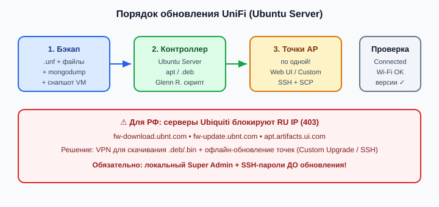
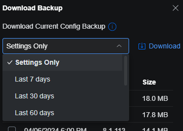
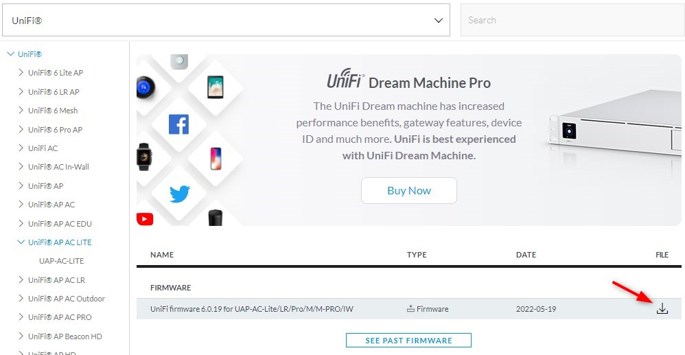

# UniFi: бэкап и обновление на Ubuntu Server

**Сценарий:** контроллер UniFi Network на Ubuntu Server → бэкап → обновление контроллера → последовательное обновление точек доступа (AP) по одной.



## Оглавление

- [0. Ограничения для РФ — прочитать первым](#0-ограничения-для-рф--прочитать-первым)
- [1. Подготовка (чек-лист)](#1-подготовка-чек-лист)
- [2. Бэкап контроллера](#2-бэкап-контроллера)
- [3. Обновление контроллера на Ubuntu](#3-обновление-контроллера-на-ubuntu)
- [4. Последовательное обновление точек доступа](#4-последовательное-обновление-точек-доступа)
- [5. Проверка и откат](#5-проверка-и-откат)
- [6. Частые ошибки](#6-частые-ошибки)

---

## 0. Ограничения для РФ — прочитать первым

> **Коротко:** «кирпичей» нет, локальный контроллер и точки работают. Но серверы обновлений Ubiquiti блокируют российские IP. Без обхода обновление через интернет не пройдёт.

| Что | Статус в РФ | Что делать |
|---|---|---|
| Локальный контроллер на Ubuntu + принятые AP | ✅ Работают как обычно | Можно обновлять |
| Серверы прошивок `fw-download.ubnt.com`, `fw-update.ubnt.com`, `fw-update.ui.com` | ❌ `403 Forbidden` / таймаут с RU IP | Качать `.bin` через VPN/прокси или обновлять офлайн (раздел 4) |
| APT-репозиторий `apt.artifacts.ui.com` | ❌ `403` с RU IP | Ставить `.deb` вручную или через Glenn R. скрипт (раздел 3) |
| Облачный доступ `unifi.ui.com` / SSO-вход | ❌ Блокировки/отключения с RU IP | **Обязательно:** локальный Super Admin + SSH-пароли до обновления! |
| Скачивание с `dl.ui.com` | ⚠️ Иногда работает напрямую | Если `403` — через VPN |

**Критично до любых действий:**

1. Создайте/проверьте **локального администратора**: `Settings → Admins & Users` (не только UI.com SSO).
2. Запишите SSH-доступ к точкам: `Settings → System → Advanced → Device Authentication`.
3. Отключите автообновления прошивок, чтобы все AP не перезагрузились разом: `Settings → System → Updates` → выключить.

> Про регион Wi-Fi: при выборе страны `Russia` недоступны 6 ГГц (Wi-Fi 6E/7) и часть каналов 5 ГГц по регуляторной таблице. Обычные 2.4/5 ГГц работают.

---

## 1. Подготовка (чек-лист)

- [ ] Локальный Super Admin создан, вход проверен.
- [ ] SSH-пароль устройств записан.
- [ ] Автообновления AP выключены.
- [ ] Есть доступ к Ubuntu по SSH.
- [ ] Подготовлен VPN/прокси для скачивания прошивок (если RU IP).
- [ ] Записаны текущие версии: контроллер (`Settings → System → About`) и AP (`Devices`).

---

## 2. Бэкап контроллера

Выполните **минимум способ А**. Лучше — А + Б.

### Способ А — через Web UI (быстро)

1. Откройте контроллер: `https://<IP>:8443` (или `:443`).
2. `Settings → System → Backups`.


3. Нажмите **Download** → выберите **Settings Only** (или полный бэкап) → скачайте файл `.unf`.



4. Сохраните `.unf` на внешнее хранилище. Проверьте размер (обычно 10–50 МБ).

> Включите **Auto Backup** (Weekly) — бэкапы хранятся локально на сервере, не в UI Account.

### Способ Б — файлы на сервере (надёжно)

```bash
# Автобэкапы контроллера
sudo ls -lh /var/lib/unifi/data/backup/
sudo cp -a /var/lib/unifi/data/backup/ /root/unifi-backup-$(date +%F)/

# Ключи и системные файлы
sudo cp -a /var/lib/unifi/data/keystore /root/unifi-backup-$(date +%F)/ 2>/dev/null
sudo cp -a /var/lib/unifi/data/system.properties /root/unifi-backup-$(date +%F)/ 2>/dev/null
```

### Способ В — дамп MongoDB (полный клон)

```bash
# Остановить контроллер на время дампа (рекомендуется)
sudo systemctl stop unifi

mongodump --db unifi --out /root/unifi-mongo-$(date +%F)

sudo systemctl start unifi
```

> Если контроллер в VM — перед обновлением сделайте снапшот VM. Это самый быстрый откат.

---

## 3. Обновление контроллера на Ubuntu

> Порядок важен: **сначала контроллер, потом точки.** Точки не обновляйте до контроллера.

### Способ 1 — APT (если репозиторий доступен)

```bash
sudo apt update
sudo apt install --only-upgrade unifi
sudo systemctl status unifi
```

Если `apt update` падает с `403` на `apt.artifacts.ui.com` — используйте Способ 2 или 3.

### Способ 2 — вручную `.deb` (для РФ)

1. Скачайте `.deb` через VPN с `dl.ui.com` или из официального репозитория Ubiquiti.
2. На сервере:

```bash
sudo dpkg -i unifi_sysvinit_all.deb
sudo apt -f install   # если попросит зависимости
sudo systemctl restart unifi
```

### Способ 3 — Glenn R. Easy Update Script

```bash
curl -s https://glennr.nl/s/unifi-easy-update | sudo bash
```

Скрипт сам скачает `.deb`, обновит MongoDB при необходимости и перезапустит контроллер.

> ⚠️ **MongoDB:** UniFi Network 8.x требует MongoDB 7.0, 9.x–10.x — MongoDB 8.0. Если после обновления контроллер не стартует — проверьте `mongosh --version` и `sudo journalctl -u unifi -f`.

### Docker (если контроллер в контейнере)

```bash
docker pull jacobalberts/unifi:latest
docker compose up -d
```

---

## 4. Последовательное обновление точек доступа

> **Правило:** обновляйте **по одной AP**. Дождитесь статуса `Connected` и стабильной работы, затем берите следующую.

### Подготовка

1. Выключите автообновления: `Settings → System → Updates`.
2. Скачайте прошивку `.bin` для вашей модели AP через VPN с `dl.ui.com/unifi/firmware/` или со страницы загрузки Ubiquiti.



3. Проверьте кэш контроллера (если прошивка уже скачана контроллером):

`Settings → System → Advanced → Device Update Cache`


### Способ 1 — Web UI, по одной (если сервер прошивок доступен)

1. `Devices` → выберите **одну** точку.
2. Нажмите **Update** (или `Settings → Manual Firmware Update`).
3. Дождитесь `Upgrading…` → `Connected`. Проверьте Wi-Fi.
4. Повторите для следующей AP.

### Способ 2 — Custom Upgrade через локальный URL (для РФ)

1. Положите `.bin` на локальный HTTP-сервер или в кэш контроллера: `/usr/lib/unifi/dl/firmware/`.
2. `Devices` → одна AP → `Settings` (шестерёнка) → **Manual Firmware Update** → **Custom Upgrade**.
3. Укажите URL: `http://<IP-контроллера>:8080/<имя-файла>.bin`.
4. Дождитесь перезагрузки и `Connected`, затем следующая AP.

### Способ 3 — SSH/SCP офлайн (самый надёжный в РФ)

```bash
# 1. Проверить место на точке
ssh <user>@<IP-точки> "df -h /tmp"

# 2. Залить прошивку
scp <файл>.bin <user>@<IP-точки>:/tmp/fwupdate.bin

# 3. Запустить обновление
ssh <user>@<IP-точки> "syswrapper.sh upgrade2 &"
```


> Точка перезагрузится сама. Не отключайте питание 5–10 минут. Проверьте в Web UI статус `Connected` и версию.

---

## 5. Проверка и откат

**После каждого шага проверяйте:**

- Контроллер открывается: `https://<IP>:8443`.
- Все AP в статусе `Connected`.
- Клиенты подключаются к Wi-Fi.
- Версии совпадают с целевыми.

**Откат контроллера:**

1. Остановите контроллер: `sudo systemctl stop unifi`.
2. Восстановите `.unf` через `Settings → System → Backups → Restore` (или `Upload & Restore`).
3. Либо верните снапшот VM / восстановите MongoDB из дампа.

**Откат точки:** залейте предыдущую `.bin` способом 3 из раздела 4.

---

## 6. Частые ошибки

| Симптом | Причина | Решение |
|---|---|---|
| `apt update` → `403` | RU IP заблокирован на `apt.artifacts.ui.com` | Способ 2/3 из раздела 3 |
| Кнопка Update на AP не работает | `fw-download.ubnt.com` → `403` | Custom Upgrade или SSH/SCP (раздел 4) |
| После обновления нет доступа | Вход только через UI.com SSO | Зайдите локальным Super Admin |
| Контроллер не стартует после обновления | Несовпадение MongoDB | Обновите MongoDB до 7.0/8.0, смотрите `journalctl -u unifi` |
| Все AP перезагрузились разом | Включены автообновления | Выключите в `Settings → System → Updates` перед работой |
| Точка не обновляется по Custom Upgrade | Неверный URL / файл не в кэше | Проверьте `/usr/lib/unifi/dl/firmware/` и доступность HTTP |

---

*Источники: документация Ubiquiti, форум ubnt.su / forum.nag.ru, блог telecom-sales.ru, Glenn R. Easy Update Script. Проверено: ноябрь 2026.*
